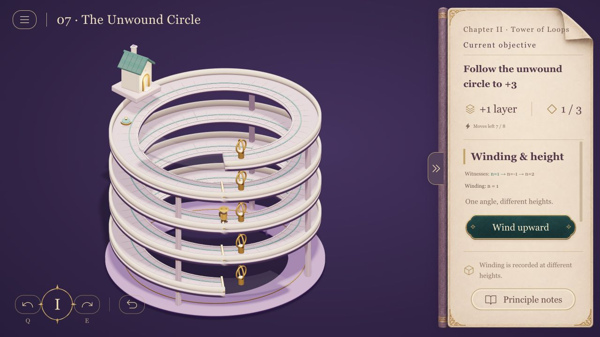

# Math Valley

[English](README.md) | [中文](README.zh-CN.md) | **日本語** | [한국어](README.ko.md)

[](https://math-valley.vercel.app/)
[](https://github.com/MartinDelophy/math-valley/actions/workflows/checks.yml)
[](https://math-valley.vercel.app/)

**公開URL: [https://math-valley.vercel.app/](https://math-valley.vercel.app/)**

立体建築を回し、層を歩き、数学の構成と証明で進むパズルゲームです。中国語・英語・日本語・韓国語に対応しています。「旅のメニュー → 言語」で切り替えても、プレイ中の状態は保たれます。



序章に加え、第1章「橋と連結」は16ステージ、第2章「回環の塔」は12ステージ。全域木、非交差経路、フローからホモトピー・被覆空間まで扱います。大学数学の基礎を持つ学習者を想定しています。

Node.js 20+ とnpmを用意し、プロジェクト直下で実行してください。

```sh
npm ci
npm run dev -- --host 127.0.0.1
```

表示されたローカルURLをWebGL対応ブラウザーで開きます。Q / Eまたはドラッグで視点を回し、場面や手帳の操作を選びます。言語とクリア記録はブラウザー内に保存されます。ページ全体の再読み込みでは現在の未完了の経路はリセットされます。

現在はプレイ可能な試作版です。[開発・検証方法](README.md)

公開版は [Vercel](https://math-valley.vercel.app/) です。GitHubの `main` へのプッシュで更新されます。[Netlify版](https://math-valley.netlify.app/)も利用できます。[公開手順](docs/deployment.md)
