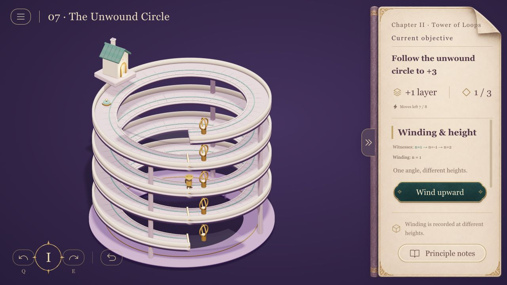

# Math Valley

[English](README.md) | [中文](README.zh-CN.md) | [日本語](README.ja.md) | **한국어**

[](https://math-valley.vercel.app/)
[](https://github.com/MartinDelophy/math-valley/actions/workflows/checks.yml)
[](https://math-valley.vercel.app/)

**온라인 주소: [https://math-valley.vercel.app/](https://math-valley.vercel.app/)**

입체 건축을 회전하고 여러 층을 탐험하며 수학적 구성과 증명으로 진행하는 퍼즐 게임입니다. 중국어 간체·번체, 영어, 일본어, 한국어, 프랑스어, 독일어, 스페인어, 포르투갈어를 지원합니다. ‘여정 메뉴 → 설정’에서 바꾸어도 현재 풀이 상태는 유지됩니다.



프롤로그와 함께 1장 ‘다리와 연결’ 16단계, 2장 ‘순환의 탑’ 12단계가 있습니다. 신장 트리, 서로소 경로, 유량부터 호모토피와 피복 공간까지 다룹니다. 대학 수학의 기초가 있는 학습자를 대상으로 합니다.

[macOS / Windows 데스크톱 버전 다운로드](https://github.com/MartinDelophy/math-valley/releases). 오프라인에서 아홉 언어와 기기 내 저장을 지원해요. Apple Silicon Mac용 DMG·ZIP, Windows 설치형·포터블 EXE. 첫 베타에는 Apple 공증과 Windows 게시자 서명이 없으며 웹과 저장 기록이 별개예요. [자세히](docs/desktop.md).

Node.js 20+와 npm을 준비한 뒤 프로젝트 폴더에서 실행하세요.

```sh
npm ci
npm run dev -- --host 127.0.0.1
```

3D 시작 화면에서 새 여행을 시작하거나 이전 진행을 이어 갈 수 있어요. 새 여행은 현재 진행을 먼저 백업한 뒤 프롤로그 학습으로 출발해요. ‘이전 여행’에서 복원할 수 있으며 게임과 학습 양쪽에서 시작 화면으로 돌아갈 수 있어요. 시작 화면에서도 언어를 바꿀 수 있어요.

표시된 로컬 URL을 WebGL 지원 브라우저로 여세요. Q / E 또는 드래그로 시점을 회전하고 장면이나 수첩의 조작을 선택하세요. IndexedDB에 완료 기록, 언어, 학습 기록, 수첩 설정과 각 퍼즐의 진행 상태를 저장하며, 새로고침 뒤에도 마지막으로 끝낸 동작부터 이어 갑니다. 경로, 증명 단계, 시점과 되돌리기 기록도 복원됩니다. 기존 localStorage 기록은 자동 이전합니다. 다른 기기나 사이트 주소와는 동기화되지 않고, 사이트 데이터를 지우면 기록도 삭제됩니다.

처음 방문하면 실제 3D 시연을 보고 독립된 작은 장면에서 직접 연습합니다. 새 장치와 증명 단계에도 해당 예제가 나오며, 네 언어로 일시 정지하거나 건너뛸 수 있습니다. ‘여행 메뉴 → 조작 시연’에서 다시 볼 수 있고, 본편의 상태와 행동 수에는 영향을 주지 않습니다.

현재 플레이 가능한 프로토타입입니다. [개발 및 검증 방법](README.md)

정식 버전은 [Vercel](https://math-valley.vercel.app/)에서 이용할 수 있습니다. GitHub의 `main`에 푸시하면 업데이트됩니다. [Netlify 버전](https://math-valley.netlify.app/)도 유지됩니다. [배포 안내](docs/deployment.md)
