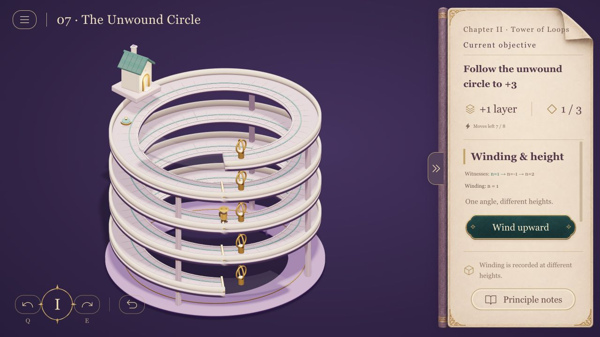
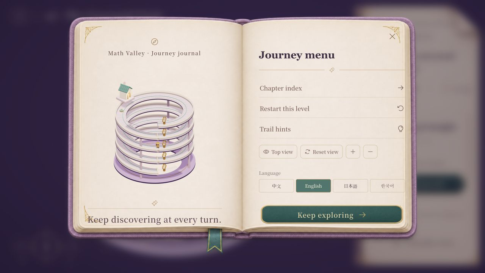

# Math Valley · 数学漫游

A playable 3D mathematics journey. Rotate miniature architecture, traverse layered galleries, build mathematical objects, and submit evidence for your solution.

**中文 · English · 日本語 · 한국어** — change language in **Journey menu → Language**. Objectives, principle notes, hints, actions, feedback and both chapters are localized. Switching language preserves the current puzzle state; the chosen language is remembered on this browser origin.



## What you can play

- **Prologue — Direction & rotation:** an introduction to rotating and walking through the world.
- **Chapter I — Bridges & Connection:** 16 levels on viewpoint passages, constrained spanning trees, disjoint paths, cuts, flow conservation and residual networks.
- **Chapter II — Tower of Loops:** 12 levels on winding numbers, inverses, path homotopy, finite covers, universal covers and noncommuting actions. Three architectural families — Moonwell Tower, Twin Courtyards and Unwound Spire — carry distinct puzzles.

The journey is for learners with some university mathematics. Observation, construction and proof are part of the game. Notes explain why a move or certificate is valid. Some levels require both travel and an independent proof stage.



## Run locally

Requires Node.js 20+ and npm. Use a browser with WebGL support.

```sh
npm ci
npm run dev -- --host 127.0.0.1
```

Open the local URL printed by Vite. To run the production build:

```sh
npm run build
npm run preview -- --host 127.0.0.1
```

On macOS, after building, you can also double-click `开始数学漫游.command`. It uses Python 3 to serve `dist/client` on an available loopback port starting at 4180. The runtime needs no account, backend or external content service.

## Controls

| Action | Control |
| --- | --- |
| Rotate camera | Drag the scene, or Q / E |
| Zoom | Mouse wheel, or Journey menu |
| Walk / operate | Click a physical platform, gate or mechanism; the journal offers contextual actions |
| Change route direction | Other directions in the journal |
| Undo | Curved arrow beside the compass |
| Principle, hint, chapter select, language | Journal / Journey menu |
| Submit | Journal action or Enter |
| Close notes | Escape |

Chapter progress is stored locally in the browser. Changing ports or browsers gives a separate save. The completed levels and last selected level are saved; an unfinished route is kept during play and language changes, and restarts on a full page reload.

## Development and validation

```sh
npm run build
npm test
```

The checks cover authored puzzle solvability, graph and topology rules, covering permutations, proof constraints, translation completeness and parameter preservation, dialog/HUD rendering across all four languages, and static packaging. A GitHub Actions workflow runs the build and tests.

- `src/chapter/` — graph-theory chapter and shared Three.js stage.
- `src/topology/` — covering-space levels, pure mathematics and geometry.
- `src/i18n/` — four-language message catalog, runtime and layout rules.
- `tests/` — mathematical, localization, render and packaging checks.
- `docs/` — screenshots and contributor notes.

See [localization notes](docs/localization.md) for adding a language and [asset credits](docs/assets.md) for the visual assets.

This is a playable prototype. Architectural ornament and difficulty balancing remain open for refinement. The game is independently authored and is not affiliated with Monument Valley or its creators.

[中文说明](README.zh-CN.md) · [日本語](docs/README.ja.md) · [한국어](docs/README.ko.md)
