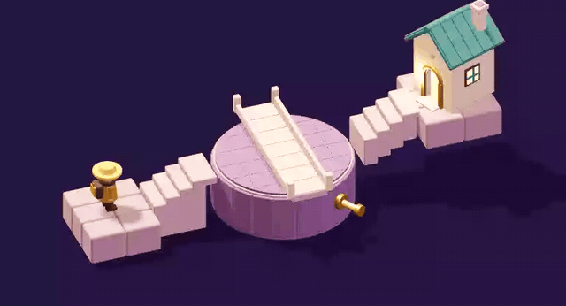

# Math Valley · 数学漫游

[English](README.md) | **中文** | [日本語](README.ja.md) | [한국어](README.ko.md)

[](https://math-valley.vercel.app/)
[](https://github.com/MartinDelophy/math-valley/actions/workflows/checks.yml)
[](https://math-valley.vercel.app/)

**在线地址: [https://math-valley.vercel.app/](https://math-valley.vercel.app/)**

通过立体空间解谜学习数学的本地网页游戏。旋转视角、探索多层建筑、操作机关，再用数学构造和证明完成关卡。



[在线试玩](https://math-valley.vercel.app/) · [下载桌面版](https://github.com/MartinDelophy/math-valley/releases) · [旋转桥关卡拆解](docs/rotation-bridge.md)

支持 **简体中文、英文、日文、韩文**。在开场页，或左上角「旅途菜单 → 设置」切换；当前层数、路径、印记和行动余量会保留，语言偏好自动保存。

- **序章**：方向与旋转。
- **第一章「桥与连通」**：16 关，包含视角穿越、带约束的生成树、不交路径、割、流与残量网络。
- **第二章「回环之塔」**：12 关，使用月井环塔、双井叠庭、螺旋高塔三种场景，探索绕数、逆路径、同伦、有限覆盖、万有覆盖与非交换作用。
- **第三章「对称之庭」**：8 关，双层镜庭将群运算、稳定子、陪集、正规性、作用的核与商群变成空间机关。
- **第四章「回声信标」**：8 关，通过分层信标探索校验矩阵、擦除恢复、综合征译码、最小距离及双错歧义。

面向已有大学数学基础的学习者。原理手记、观察提示和独立证明均融入关卡；部分关卡需要同时完成行走与证据验证。

## 桌面版

[下载 macOS / Windows 桌面版](https://github.com/MartinDelophy/math-valley/releases)。游戏资源随应用提供，可离线游玩，保留九种语言和本机存档。提供 Apple Silicon Mac 的 DMG 与 ZIP，以及 Windows 安装版和便携版 EXE。首个测试版尚未进行 Apple 公证或 Windows 发布者签名；桌面存档与网站存档相互独立。详见[桌面构建与发布说明](docs/desktop.md)。


## 运行

准备 Node.js 20+、npm 和支持 WebGL 的浏览器。

```sh
npm ci
npm run dev -- --host 127.0.0.1
```

访问终端显示的网址。生产版本：

```sh
npm run build
npm run preview -- --host 127.0.0.1
```

macOS 在构建后也可以双击 `开始数学漫游.command`，通过 Python 3 启动本地版本。Q / E 切换视角，拖动画面旋转，滚轮缩放；点击实体场景或手札执行操作，罗盘旁的箭头可撤回。左上菜单提供章节、原理、提示和语言。

3D 开场提供「开始旅程」「继续旅程」和「往昔旅程」。开始新旅程会先备份当前进度，再进入序章教学；旧旅程可以随时恢复。游戏和教学中都可以「回到开场」。

数据保存在浏览器的 IndexedDB 中，包括通关、教学记录、语言、手札设置，以及每关最近完成一步后的解题状态。刷新或重新打开后可继续路线、流量和证明阶段，也保留视角与撤销历史。旧 localStorage 存档会自动迁移。不同浏览器、设备或网站域名分别存档，清理站点数据会清除本机记录。详见 [本机存档说明](docs/storage.md)。

首次进入会先看到真实 3D 教学，再在独立小场景中亲手验证。新机制及证明阶段首次出现时，也有对应示例。教学支持九种语言，可暂停、跳过，并从「旅途菜单 → 教学演示」重看；不改变正在解题的状态，也不消耗正式关卡行动。

```sh
npm run build
npm test
```

目前为可玩原型，美术细节和难度仍可迭代。更多开发信息见 [English README](README.md)。

## 部署

正式入口：[https://math-valley.vercel.app/](https://math-valley.vercel.app/)。Vercel 已连接本 GitHub 仓库，推送到 `main` 会自动构建并部署。

项目提供 [vercel.json](vercel.json)，构建命令为 `npm run build`，发布目录为 `dist/client`。手动部署：

```sh
npx vercel link --project math-valley
npx vercel build --prod
npx vercel deploy --prebuilt --prod
```

### Netlify 备用版本

[https://math-valley.netlify.app/](https://math-valley.netlify.app/) 继续保留。对应配置是 [netlify.toml](netlify.toml)，同样发布 `dist/client`。

详细维护流程见 [部署说明](docs/deployment.md)。

支持简体中文、繁體中文、English、日本語、한국어、Français、Deutsch、Español、Português。在开场齿轮或旅途菜单的设置中切换语言、音乐、音效和动画。背景音乐为巴赫《C大调前奏曲》的 CC0 钢琴录音。数学原理通过文字手记与独立教学演示呈现，不含 TTS。

右侧手札采用「观察 / 论证」分页，主要操作固定在底部。更新以稳定关卡 ID 延续进度，新关卡单独提示。开场的「旅程存档」支持导出、导入 JSON 备份，恢复前自动保留当前旅程。详见[存档与更新](docs/save-format.md)。

现有 **44 个正式关卡 + 序章**。新增章节会自动加入目录，原有完成记录与关内状态保留；[章节数学与设计依据](docs/chapters-iii-iv.md)。

## 许可证

本项目源代码与代码文档采用 [MIT 许可证](LICENSE)。游戏美术、截图、视频、音频、字体及其他媒体素材不在此授权范围内。适用条款见[素材说明](docs/assets.md)和[第三方声明](public/THIRD-PARTY-NOTICES.txt)。
