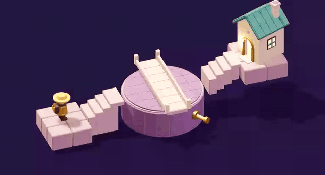

# 我把九十度旋转做成了一座桥

[在线试玩《数学漫游》](https://math-valley.vercel.app/) · [查看 GitHub 仓库](https://github.com/MartinDelophy/math-valley)

小旅人站在台阶上，对面就是屋子。中间的桥横着摆，两头都没接上路。你点一下铜把手，桥转过四分之一圈。这时两端刚好对上台阶，小旅人就能走过去。

这是《数学漫游》的序章。我想让玩家先动手接通这条路，再回过头看，自己刚才用了什么数学。

## 桥转了，桥头能到的范围有多大？

想象用笔尖沿着桥头走一圈。只要桥绕固定转轴转，笔尖就会画出一个圆。桥头到转轴的距离始终等于圆的半径。于是可以把问题拆成两步：

1. **先看距离。** 台阶的接点如果离转轴太远或太近，怎么转都接不上。
2. **再看方向。** 这座桥按九十度停靠。就算接点恰好在圆上，也得落在桥头能停住的方向上。

序章把两端的距离预先配好，让玩家专注于第二步。桥横着时，桥头朝向左右。转过九十度后，桥头朝向前后，两边的台阶同时接通。因为桥的两头对称，再转半圈仍然能接通。

## 游戏怎么判断可以过桥？

[序章的实现](../src/game.js)把画面和通行判定分开了。玩家点击把手时，目标角度按九十度对齐，Three.js 用约 750 毫秒把桥转到目标位置。动画期间先锁住通行，等桥停稳后才允许走。

通行条件是 `Math.abs(Math.sin(targetAngle)) < .01`。在这一关的坐标系里，目标角度为 0° 或 180° 时，桥才沿着连接两侧台阶的轴线。正弦接近零就表示桥对齐了。台阶和桥的接点位置由关卡预先摆好，因此这里可以用一个角度条件判断。

先让玩家看见桥怎么转，再让小旅人用脚验证路有没有接通。同一个动作里，玩家既看到结果，也有机会猜到规律。下一次遇到转轴和落点，哪怕还没动手，也可以先问一句：**这个点在桥头能到的圆上吗？**
